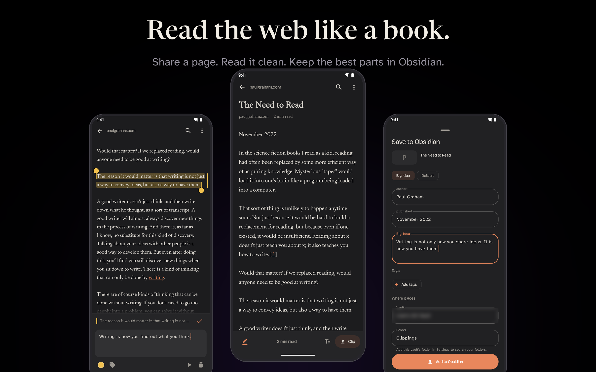
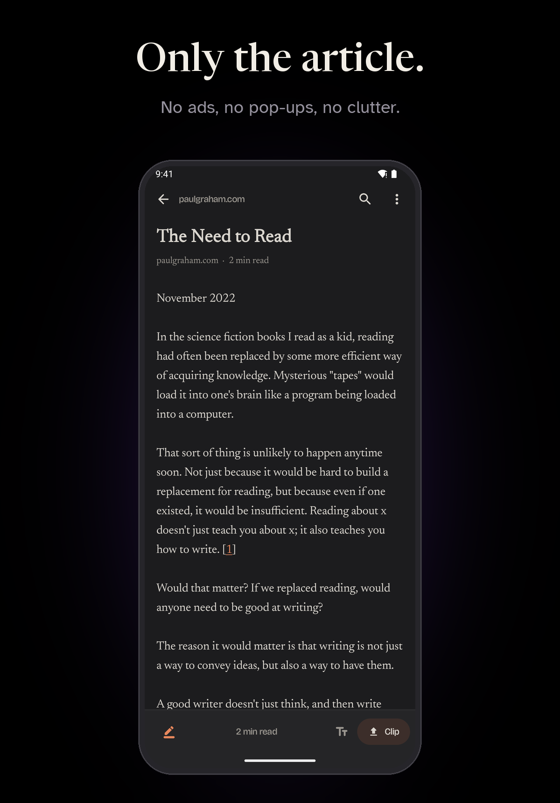
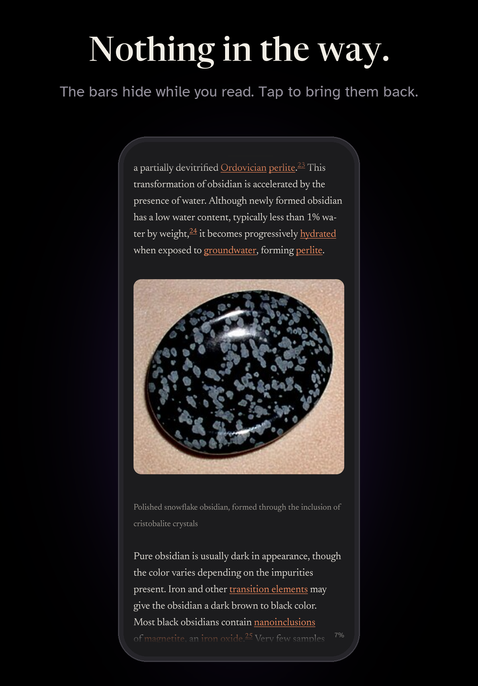
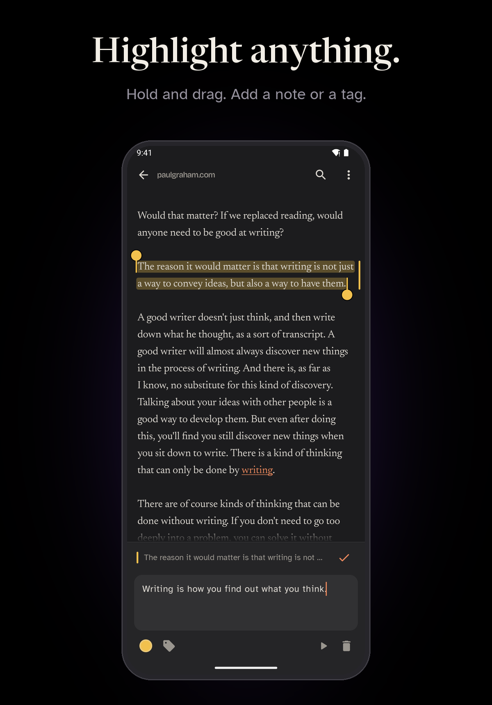
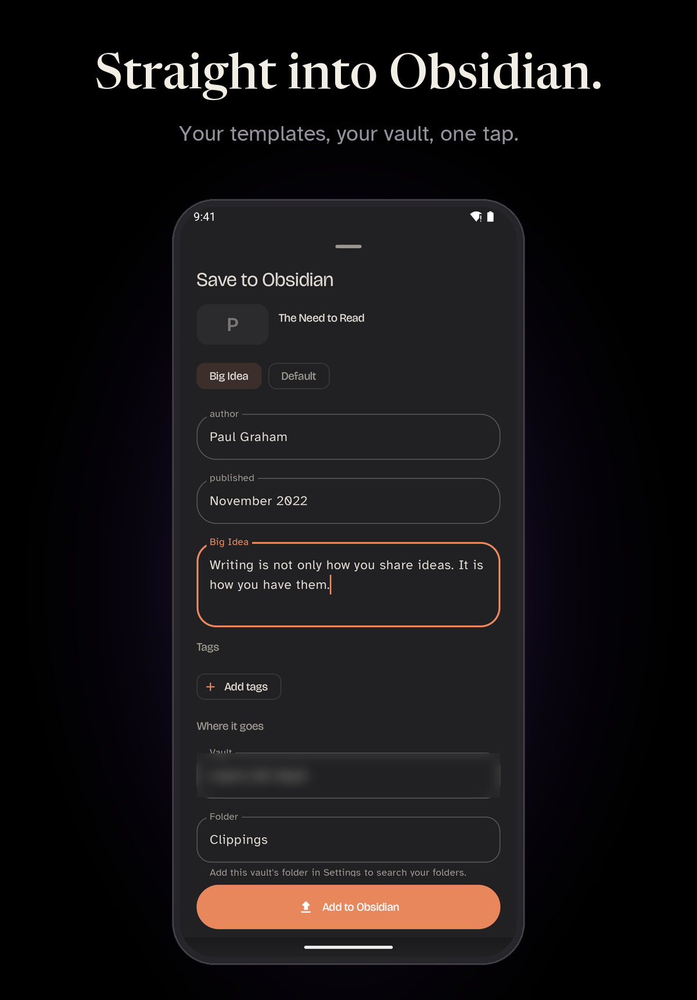
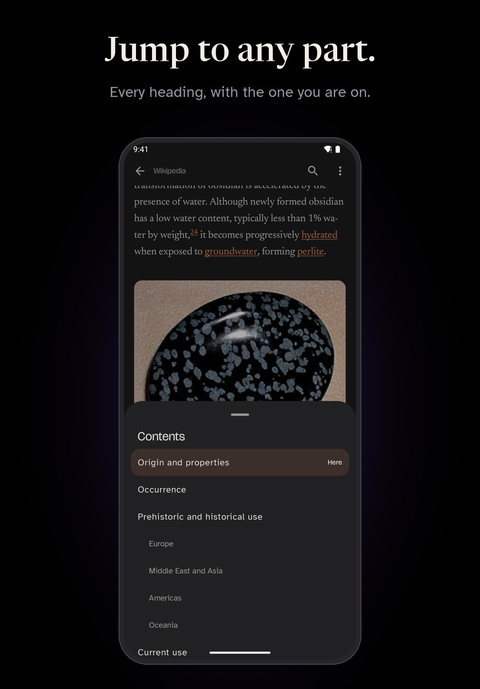
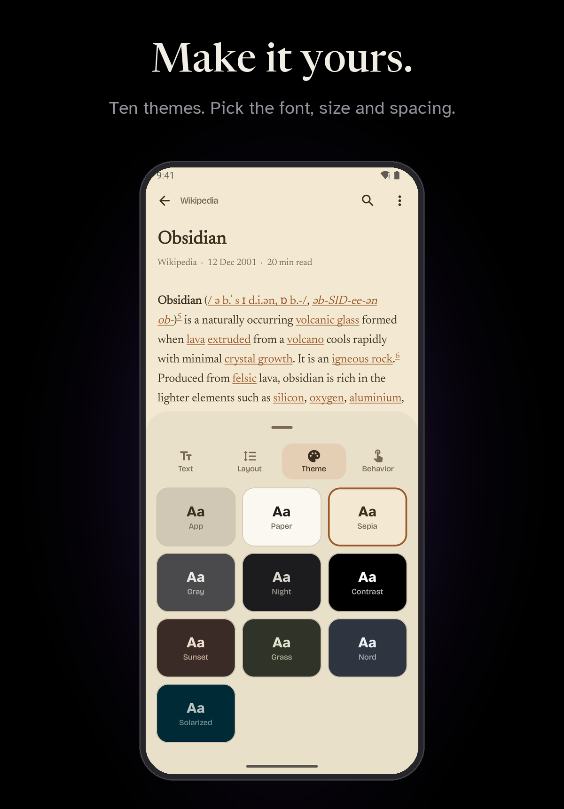
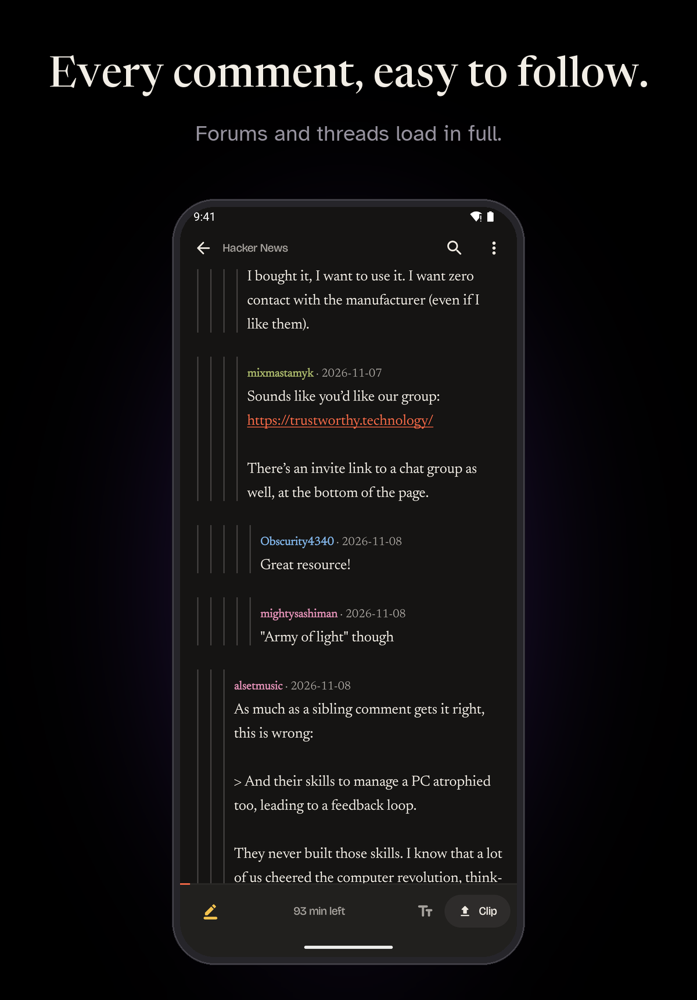
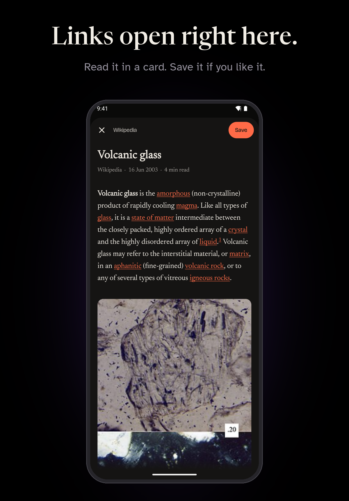

<p align="center">
  <a href="../../releases/latest"></a>
  
  
  <a href="LICENSE"></a>
</p>

<h1 align="center">ObsiRead</h1>

<p align="center">
  <b>Read the web like a book. Keep what matters in Obsidian.</b><br>
  Share a page from your browser. ObsiRead reads it the way Obsidian Web Clipper does and shows it in a clean reader.
</p>

<p align="center">
  <a href="../../releases/latest"><b>Download the latest APK</b></a>
</p>

<p align="center"></p>

---

## A closer look

<table>
  <tr>
    <td width="50%"></td>
    <td width="50%"></td>
  </tr>
  <tr>
    <td width="50%"></td>
    <td width="50%"></td>
  </tr>
  <tr>
    <td width="50%"></td>
    <td width="50%"></td>
  </tr>
  <tr>
    <td width="50%"></td>
    <td width="50%"></td>
  </tr>
</table>

## How it works

1. **Share.** In your browser, tap Share and pick ObsiRead.
2. **Read.** The page opens with only the article: text, headings, lists, quotes, code, tables and its own pictures.
3. **Highlight.** Hold a word and drag. Add a note and tags.
4. **Clip.** One tap makes a clean note in your Obsidian vault, with links back to each highlighted sentence.

## Features

### Read

| | |
|---|---|
| **The Web Clipper reader** | Pages are read by [Defuddle](https://github.com/kepano/defuddle), the same reader inside Obsidian Web Clipper. |
| **Real pages** | The page loads in the phone's own browser engine, so pages that build themselves with scripts read the way you see them. |
| **Pictures in place** | The article's own pictures show where they belong. Nothing extra is added. |
| **Contents** | Tap the time left at the bottom to see every heading. The one you are on is marked. Tap one to jump there. |
| **Comments in full** | Forums and comment threads load every reply. Each reply sits under the one it answers. |
| **Your way to read** | Ten themes, five fonts, and controls for size, weight, spacing and margins. Tap the page to hide or show the bars. |
| **Links stay in the app** | A link opens in a reading card over the article. Tap Save to keep it. |
| **Sign-in pages** | A page that wants you to sign in opens in the app's browser. Sign in, then tap Read this page. Your sign-in stays. |
| **Pick up where you left off** | Each article opens where you stopped. |
| **Find** | Search inside an article, or across all your titles, highlights and notes. |

### Clip to Obsidian

| | |
|---|---|
| **Your vault templates** | Pick a note from your vault. ObsiRead reads its properties and sets them up. |
| **Web Clipper settings** | Import and export Obsidian Web Clipper templates. |
| **Links to the sentence** | Each highlight links back to its exact place on the web page. |
| **Safe updates** | Clip again and only the new highlights are added. Your writing stays. |
| **Review** | Old highlights come back in short rounds. |

### Coming next

- Read aloud with good voices: the phone's, cloud voices, and offline voices.
- RSS feeds.

## Article data for templates

`title` `url` `author` `published` `site` `domain` `description` `image` `favicon` `language`
`content` `article` `highlights` `highlightCount` `words` `minutes` `readingTime` `tags` `category` `date` `time` `id`

Obsidian's `{{date}}`, `{{time}}` and `{{date:FORMAT}}` work in templates. So do Web Clipper filters such as `{{title|lower}}`.

## Build

You need JDK 21 and the Android SDK, platform 36.

```bash
JAVA_HOME=/path/to/jdk-21 ./gradlew assembleRelease
```

Run the unit tests:

```bash
./gradlew testDebugUnitTest
```

## Releases

Write `docs/releases/v<version>.md`, then run `scripts/release.ps1 -Version <version>`. GitHub Actions builds, signs and publishes the APK. The app then shows an update pop-up.

## Stack

Kotlin, Jetpack Compose, Material 3 Expressive, Defuddle, jsoup and Coil.

## Licence

ObsiRead is free software under the [GNU General Public License v3.0](LICENSE). Defuddle is MIT licensed; its licence ships in `app/src/main/assets/defuddle-LICENSE.txt`.

ObsiRead is not affiliated with Obsidian.
